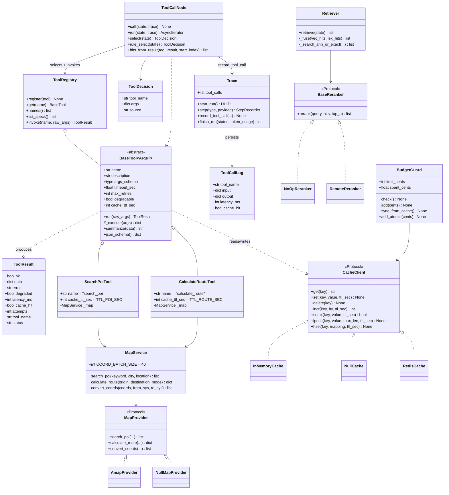
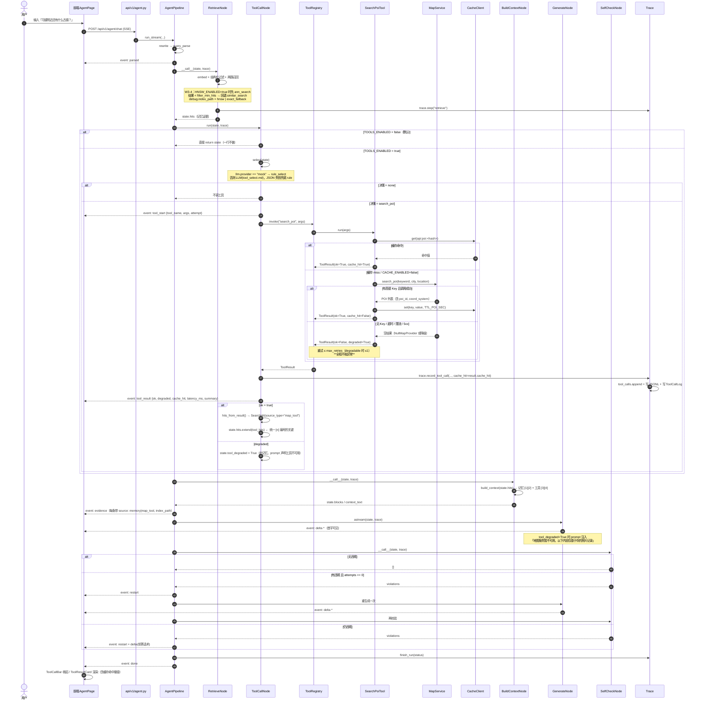
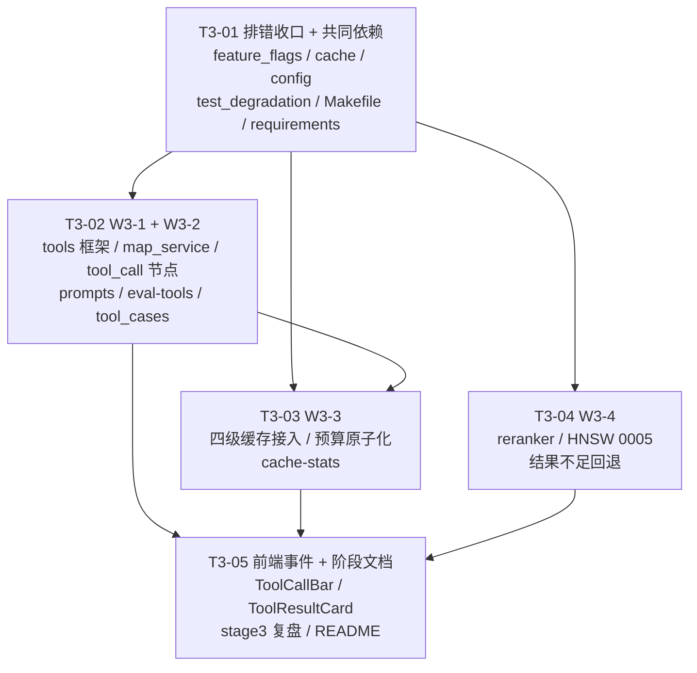

# 阶段 3 增量系统设计：工具调用 + Reranker + 缓存

> 本文是**增量设计**，只描述「阶段 3 相对阶段 2 的变更」。
> 未提及的行为一律沿用阶段 2 现状，不得顺手改动。
> 需求基线：[stage3-prd.md](./stage3-prd.md)；红线：[PROJECT.md](../../PROJECT.md)；规格：[旅忆地图 TravelMemory.md](../../旅忆地图%20TravelMemory.md)。

| 项 | 内容 |
| --- | --- |
| 项目 | 旅忆地图 TravelMemory（`F:/project/travelmemory`） |
| 阶段 | 阶段 3（W3-1 / W3-2 / W3-3 / W3-4）+ 仓库排错 O-1~O-5 |
| 当前基线 | `pytest` 99 passed / 9 skipped；`ruff check .` + `mypy app` 全绿；`npm run build` 通过 |
| prompt_version | `pv2026.10-stage2.1` → **`pv2026.10-stage3.1`**（Q4 已拍板） |
| 运行环境约束（E1） | **无 Docker / Redis / PostgreSQL / LLM Key / 高德 Key**。每条新增逻辑必须有不依赖外部服务的自动化测试 |

---

## 0. 一句话结论（给工程师的导航）

阶段 3 只往现有管道里**插入一个节点**（`tool_call`）并在**两个既有算法位上加可选开关**（`_fuse` 之后的 rerank、`similar_search` 之前的 HNSW）。
除此之外：

- **不动** `utils/citation.py`、`self_check.py`、`rag/context_builder.py` —— 工具事实靠「转成 `SearchHit` 追加进 `state.hits`」自然拿到统一 `[n]` 编号，引用率 100% 的硬校验天然覆盖它（PRD §7.3 默认方案）。
- **不改** `Trace` 的写入口 —— `trace.record_tool_call(...)` 在 `observability.py:146` 已经存在且签名齐全，本阶段只需补一个内存累积列表供单测断言。
- **不新增必装 pip 依赖** —— `redis` 走惰性 import + `ImportError` 降级，默认走 `InMemoryCache`。

---

# Part A · 系统设计

## 1. 实现方案与选型

### 1.1 四个技术挑战

| # | 难点 | 现状证据 | 处理方式 |
| --- | --- | --- | --- |
| C1 | **工具事实如何可引用**：引用率 100% 是硬指标，工具返回的事实不能绕开 `utils/citation.py` | `citation.py:18` 的 `CITATION_RE` 只认 `[n]`；`self_check` 用 `len(state.blocks)` 做越界检查 | 工具结果 → `SearchHit(source_type="map_tool")` → **追加到 `state.hits` 尾部** → `build_context` 照常连续编号（记忆 `[1][2]` + 工具 `[3][4]`）。**零改动**达成 PRD §7.3 |
| C2 | **无外部服务时如何验证**：四个出口条件都要出数值 | 无 Docker / 无 Key（E1） | 三个替身：`InMemoryCache`（缓存语义全覆盖）、`NullMapProvider` + 注入式 fake provider（外部 API）、`InMemoryVectorSearch.ann_search`（HNSW 语义替身） |
| C3 | **失败必须降级而非抛错**（PROJECT.md 第 8 条） | 现有节点任一抛错会让 `run_stream` 走 `except` 直接失败 | `BaseTool.run()` 是**模板方法**，内部吞掉全部异常；工具层永不抛出，只返回 `ToolResult(ok=False, degraded=True)` |
| C4 | **关闭开关必须逐条等同阶段 2** | `make test-degradation` 目前指向一个不存在的文件（O-1） | 三个新 flag 默认 `False`；`ToolCallNode` 在 flag 关闭时 `return state`（一行不做）；`NoOpReranker` 原序返回；兜底由 `tests/test_degradation.py` 断言阶段 2 指标快照 |

### 1.2 各模块的形态选型

| 模块 | 选定形态 | 为什么 | **被否掉的备选**（及否决理由） |
| --- | --- | --- | --- |
| 工具框架 | 自写 `BaseTool`(ABC + Generic[ArgsT]) + `ToolRegistry` + Pydantic v2 `args_schema` | 只有 2 个工具，LangChain 的 `BaseTool` 会带进 `langchain-core` 全家桶与一套我们不需要的 `run/arun` 双协议；且阶段 4 要迁 LangGraph，自写的 `__call__` 节点能原样搬成 `call_tool` | ❌ LangChain Tool / ❌ OpenAI function-calling 原生 schema：前者依赖太重，后者把"选工具"绑死在单次 LLM 调用上，mock 下无法评测（违反 R3-1.6） |
| 工具选择位置 | `nodes/pipeline/tool_call.py`，插在 `retrieve` 之后、`build_context` 之前（Q1 已拍板） | 阶段 4 迁 graph 时该节点可原样搬成 `call_tool`；放在 retrieve 之后的好处是**能拿到 `parsed`**（地名 → `city` 入参） | ❌ 放在 `query_parse` 里：会让解析节点承担"执行"职责，且工具失败无法走检索降级 |
| 工具选择算法 | **LLM 选择 + 规则兜底双路**；`llm.provider == "mock"` 时**直接走规则**，不发起 LLM 调用 | R3-1.6 要求"无 Key 也能跑出准确率数值"。若让 mock 返回 `{"tool": null}`，20 条用例里 5 条负例 → 准确率 0.25，出口条件永远过不了 | ❌ 纯 LLM 选择：离线跑不出数值；❌ 纯规则：真实 LLM 下泛化差（"乌镇方圆十公里有啥玩的"没有"附近"二字） |
| 缓存 | `CacheClient` **Protocol** + `InMemoryCache`（默认）+ `RedisCache`（`CACHE_ENABLED=true`）+ `NullCache`（直通） | Protocol 让两个实现共用同一组单测；`NullCache` 是 `test-degradation` 要的"缓存完全不参与"基线 | ❌ fakeredis（Q3 已否：新依赖 + 需可安装）；❌ 直接用 `redis.Redis` 硬依赖（违反 E1） |
| Reranker | `BaseReranker` Protocol + `NoOpReranker` + `RemoteReranker`（OpenAI 兼容 `/rerank`）；**无 key / 无模型 → NoOp** | 必须有 no-op 才能断言"开启前后顺序逐条一致"（R3-4.1）。本地 bge-reranker 需 GPU，环境不具备，故本阶段**只落 Remote 实现 + 无 key 自动 NoOp**，本地模型留待有 GPU 时按同一 Protocol 补 | ❌ 直接改 `_fuse` 权重：那是 D-6，不在本轮范围 |
| HNSW | alembic `0005` 建索引 + `DocumentService.ann_search`（先 ANN 后过滤）+ **Retriever 侧回退到精确扫描** + `InMemoryVectorSearch.ann_search` 语义替身 | 回退决策放在 Retriever 层，才能用内存替身单测；SQL 只负责"按 HNSW 顺序取候选"，语义清晰 | ❌ 在 SQL 里用 CTE 一次搞定"不足则回退"：无法在无库环境验证，且会把 pgvector 的执行计划不确定性藏进 SQL |
| 预算计数 | `BudgetGuard` 增加可选 `CacheClient`，用 `INCR`（存 **millicents 整数**）+ 当日 TTL | Redis `INCR` 只支持整数，成本是浮点，必须换单位；`check()` 保持同步语义不变，只在有 cache 时先 `sync_from_cache()` | ❌ 直接把 `BudgetGuard` 改成 async-only：会让 `chat()` 的两处调用全部改签名，风险大收益小 |

### 1.3 架构模式

阶段 3 仍是**纯 Python 管道**（`AGENT_RUNTIME=pipeline`），节点契约统一为：

```python
async def __call__(self, state: PipelineState, trace: Trace) -> None
```

新增的 `ToolCallNode` 在此契约之上额外提供一个**事件生成器**：

```python
async def run(self, state, trace) -> AsyncIterator[dict]   # 产出 tool_start / tool_result
async def __call__(self, state, trace) -> None            # 把 run() 的事件的丢掉，保持节点契约
```

这样 `pipeline.run_stream` 只需 `async for ev in self.tool_call.run(state, trace): yield ev`，
非流式路径（`run()`）调用 `__call__`，**两条路径行为完全一致**（这是阶段 2 就立下的规矩：评测跑非流式、线上跑流式，行为必须相同）。

---

## 2. 文件清单

> `新增` = 本阶段创建；`修改` = 改既有文件（**只允许扩展，不允许放宽既有断言**）。
> 「块」列：W3-1~W3-4 / O-1~O-5 / FE（前端）/ DOC（文档）/ T3-0x（交付批次，见 §7）。

### 2.1 后端 · core 层（共同依赖）

| 路径 | 新增/修改 | 职责 | 块 | 批次 |
| --- | --- | --- | --- | --- |
| `backend/app/core/feature_flags.py` | **新增** | 8 个开关的统一入口：`is_enabled(name)` / `all_flags()`；阶段 7 的 4 个既有开关一并纳入 | O-2 / R3-1.5 | T3-01 |
| `backend/app/core/cache.py` | **新增** | `CacheClient` Protocol + `InMemoryCache` + `NullCache` + `RedisCache`（惰性 import）+ `build_cache()`；TTL 常量与 key 构造器 | O-4 / R3-3.1 | T3-01 |
| `backend/app/core/config.py` | 修改 | 新增阶段 3 配置字段（`tools_enabled` 等 4 个 flag + 高德 / rerank / 工具 / 缓存参数） | R3-1.5 / R3-2.6 | T3-01 |
| `backend/app/core/llm.py` | 修改 | `BudgetGuard` 支持可选 `CacheClient` 做原子计数；`MockLLM._route` 增加 `tool_select` 分支（防御性） | R3-3.5 | T3-03 |

### 2.2 后端 · services / tools 层

| 路径 | 新增/修改 | 职责 | 块 | 批次 |
| --- | --- | --- | --- | --- |
| `backend/app/services/map_service.py` | **新增** | `MapProvider` Protocol + `AmapProvider`（httpx）+ `NullMapProvider` + `MapService`（**分批 ≤40 点 / 缓存 / 限流 / 标注 `coord_system`**）+ `build_map_provider()` | W3-2 / R3-2.1,2.4,2.6 | T3-02 |
| `backend/app/tools/__init__.py` | **新增** | 空（目录当前连它都没有） | W3-1 | T3-02 |
| `backend/app/tools/base.py` | **新增** | `ToolResult` dataclass + `BaseTool`(ABC, Generic) 模板方法：schema 校验 → 缓存 → 超时 → 重试 → 降级 | W3-1 / R3-1.1 | T3-02 |
| `backend/app/tools/registry.py` | **新增** | `ToolRegistry`：注册 / 按名发现 / `invoke()` / `list_specs()`（导出给 LLM 的 JSON Schema） | W3-1 / R3-1.2 | T3-02 |
| `backend/app/tools/poi_tool.py` | **新增** | `search_poi`：`keyword / city / location` → 含**高德 POI ID** 的 POI 列表 | W3-2 / R3-2.2 | T3-02 |
| `backend/app/tools/route_tool.py` | **新增** | `calculate_route`：`origin / destination / mode` → `distance_m / duration_sec / steps` | W3-2 / R3-2.3 | T3-02 |

### 2.3 后端 · agent 层

| 路径 | 新增/修改 | 职责 | 块 | 批次 |
| --- | --- | --- | --- | --- |
| `backend/app/agent/nodes/pipeline/tool_call.py` | **新增** | `ToolCallNode`：选工具 → 调工具 → 转证据 → 写 `ToolCallLog` → 产出 SSE 事件 | W3-1 / R3-1.3,1.4 | T3-02 |
| `backend/app/agent/nodes/pipeline/__init__.py` | 修改 | 导出 `ToolCallNode` | W3-1 | T3-02 |
| `backend/app/agent/pipeline.py` | 修改 | 装配 `ToolCallNode`；`run_stream` 在 `retrieve` 后转发工具事件；`_evidence_event` 增加 `source` 与 `index_path` | W3-1 / §7.1 | T3-02 |
| `backend/app/agent/state.py` | 修改 | `PipelineState` 增加 `tool_degraded` / `tool_results`；**不新增** `ToolCallLog` 相关字段 | W3-1 | T3-02 |
| `backend/app/agent/observability.py` | 修改 | `Trace` 增加 `tool_calls: list[dict]` 内存累积（供单测断言），`record_tool_call` 里 append 一行 | R3-1.4 | T3-02 |
| `backend/app/agent/prompts/tool_select.md` | **新增** | 工具选择 prompt（输出 `{"tool": ..., "args": {...}}`） | W3-1 / E7 | T3-02 |
| `backend/app/agent/prompts/generate.md` | 修改 | 增加 `{{tool_note}}` 占位（工具不可用 / 工具事实同样要带 `[n]` 两句约束） | §7.3 / E7 | T3-02 |
| `backend/app/agent/prompts/loader.py` | 修改 | `PROMPT_VERSION` → `pv2026.10-stage3.1` | E7 / Q4 | T3-02 |
| `backend/app/agent/rag/reranker.py` | **新增** | `BaseReranker` Protocol + `NoOpReranker` + `RemoteReranker` + `build_reranker()` | W3-4 / R3-4.1 | T3-04 |
| `backend/app/agent/rag/retriever.py` | 修改 | `RetrieverConfig` 加 rerank / hnsw 字段；`Retriever` 接 reranker 与 `ann_search` 回退；`RetrieverDebug` 加 `index_path` / `reranked` | W3-4 / R3-4.2,4.3 | T3-04 |
| `backend/app/agent/rag/ports.py` | 修改 | `VectorSearchPort` 增加 `ann_search()` | W3-4 / R3-4.3 | T3-04 |
| `backend/app/services/document_service.py` | 修改 | 实现 `ann_search()`（内层 ANN 取候选、外层施加过滤，正是会返回 0 条的那条路径） | W3-4 / R3-4.3 | T3-04 |
| `backend/app/agent/eval/runner.py` | 修改 | `--tools` 分支（**在数据库探活之前返回**，保证离线可跑）；`--ablation` 增加「+rerank」档 | O-3 / R3-4.2 | T3-02（--tools）/ T3-04（rerank 档） |
| `backend/app/agent/eval/dataset.py` | 修改 | `load_tool_cases()` 读 `data/tool_cases.jsonl` | O-3 | T3-02 |
| `backend/app/scripts/cache_stats.py` | **新增** | `make cache-stats`：合成序列 or 读 trace JSONL，输出 POI/路线类命中率 | O-3 / R3-3.6 | T3-03 |

### 2.4 后端 · 数据、迁移、测试、工程文件

| 路径 | 新增/修改 | 职责 | 块 | 批次 |
| --- | --- | --- | --- | --- |
| `backend/data/tool_cases.jsonl` | **新增** | ≥20 条工具选择评测集（含 ≥5 条 `expect_tool: "none"` 负例） | W3-1 / R3-1.3 | T3-02 |
| `backend/alembic/versions/0005_stage3_hnsw.py` | **新增** | HNSW 索引（`vector_cosine_ops`），**必须带 downgrade** | W3-4 / R3-4.3 | T3-04 |
| `backend/tests/test_feature_flags.py` | **新增** | 默认全关 / 环境变量可覆盖 / 禁止 `os.getenv` | O-2 | T3-01 |
| `backend/tests/test_cache.py` | **新增** | 三个实现对同一组语义（get/set/ttl/delete/incr/setnx）行为一致；TTL 数值；key 前缀白名单 | R3-3.1,3.2,3.7 | T3-01 |
| `backend/tests/test_layering.py` | **新增** | 依赖方向守卫：`app/tools/**` 不得 import `app.agent` / `app.api` | E4 | T3-01 |
| `backend/tests/test_degradation.py` | **新增** | **O-1**：4 个新 flag 全关 → 阶段 2 指标快照不退化 | O-1 / E3 | T3-01 |
| `backend/tests/test_tools_base.py` | **新增** | schema 失败 / 超时 / 重试次数 / `degradable` 重试 ≤1 | R3-1.1 | T3-02 |
| `backend/tests/test_tools_registry.py` | **新增** | `list_specs` 覆盖 / 未注册不得 KeyError / 重复注册报错 | R3-1.2 | T3-02 |
| `backend/tests/test_tool_call_node.py` | **新增** | flag 关 → 跳过；规则兜底准确率；`trace.tool_calls` 恰好一行且含 `cache_hit` | R3-1.3,1.4,1.6 | T3-02 |
| `backend/tests/test_map_service.py` | **新增** | 无 Key 降级不抛错；120 点 → 3 批；二次转换 `cache_hit`；所有位置带 `coord_system` | R3-2.1,2.4 | T3-02 |
| `backend/tests/test_poi_route_tools.py` | **新增** | POI ID 非空；路线结构完整；限流返回 degraded；**工具证据并入统一 `[n]` 后 `citation_rate` 口径不变** | R3-2.2,2.3,2.5,2.6 | T3-02 |
| `backend/tests/test_budget_atomic.py` | **新增** | 10 协程并发 INCR → 计数 == 10；超限抛 `LLMBudgetExceeded` 且不 500 | R3-3.5 | T3-03 |
| `backend/tests/test_embedding_cache.py` | **新增** | 计数型 mock：同批文档二次索引 → provider 调用次数 == 0 | R3-3.3 | T3-03 |
| `backend/tests/test_session_state.py` | **新增** | 滑动窗口长度 ≤ 配置；TTL = 24h | R3-3.4 | T3-03 |
| `backend/tests/test_reranker.py` | **新增** | NoOp 顺序逐条一致；无 key 自动 NoOp 不抛错 | R3-4.1 | T3-04 |
| `backend/tests/test_retriever_rerank.py` | **新增** | 开关前后顺序相同；rerank 调用次数 == 1；候选 ≤ 20 | R3-4.2,4.4 | T3-04 |
| `backend/tests/test_hnsw_fallback.py` | **新增** | 过滤后 0 条 → 触发精确扫描 → 结果非空；`index_path` 正确 | R3-4.3,4.5 | T3-04 |
| `backend/tests/test_migration_0005.py` | **新增** | 不连库编译断言：revision / down_revision / 索引名 / ops / with 参数；downgrade 存在 | R3-4.3 | T3-04 |
| `backend/tests/fakes.py` | 修改 | `InMemoryVectorSearch` 增加 `ann_search()`（HNSW 语义替身）；新增 `FakeMapProvider`（计数型） | 全程 | T3-02 / T3-04 |
| `backend/requirements.txt` | 修改 | `redis` 以**注释形式**标注为可选（不参与 `pip install`）；写明降级路径 | O-4 | T3-01 |
| `Makefile` | 修改 | 新增 `eval-tools` / `cache-stats`；`.PHONY` 同步 | O-3 | T3-01 |
| `backend/pyproject.toml` | 修改（**仅当** mypy 报第三方缺失时） | 必要时加 `[[tool.mypy.overrides]] module="redis.*" ignore_missing_imports=true` | O-4 | T3-01 |

### 2.5 前端

| 路径 | 新增/修改 | 职责 | 块 | 批次 |
| --- | --- | --- | --- | --- |
| `frontend/src/types/agent.ts` | 修改 | 新增 `ToolStartPayload` / `ToolResultPayload` / `EvidenceSource`；`EvidenceBlock` 加 `source`；`AgentEvent` 加两个事件；`ChatMessage` 加 `toolCalls` | §7.1 / §7.4 | T3-05 |
| `frontend/src/pages/AgentPage/ToolCallBar.tsx` | **新增** | 流式期间气泡上方：「正在查地图：search_poi(…)」+ spinner | §7.2-1 | T3-05 |
| `frontend/src/pages/AgentPage/ToolResultCard.tsx` | **新增** | POI 名/地址/POI ID（可折叠）或距离时长；顶部固定标注"来自高德地图，不是你的照片记录"；`cache_hit` 徽章；`degraded` 降级提示 | §7.2-2,3,5 | T3-05 |
| `frontend/src/pages/AgentPage/EvidenceList.tsx` | 修改 | 按 `source` 打标签（`memory`→「你的记录」/`map_tool`→「地图工具」）；**共用同一套 `[n]`** | §7.2-4 | T3-05 |
| `frontend/src/pages/AgentPage/AgentPage.tsx` | 修改 | 处理 `tool_start` / `tool_result` 事件；在气泡区渲染 `ToolCallBar` / `ToolResultCard` | §7.2 | T3-05 |
| `frontend/src/pages/AgentPage/index.ts` | 修改 | 导出新组件（可选） | §7.4 | T3-05 |

### 2.6 文档

| 路径 | 新增/修改 | 职责 | 批次 |
| --- | --- | --- | --- |
| `docs/stages/stage3-tools-rerank.md` | **新增** | 阶段复盘，按 `docs/stages/README.md` 固定 7 节结构 | T3-05 |
| `docs/stages/README.md` | 修改 | 表格状态：`stage3-tools-rerank.md` 由「待开始」→ 已完成 | T3-05 |
| `README.md` | 修改 | 「阶段 3 已在阶段 2 之上跑通」段落 + 常用命令表补 `eval-tools` / `cache-stats` | T3-05 |
| `docs/design/stage3-architecture.md` | 本文 | — | — |

---

## 3. 核心接口定义

> 全部带类型标注。以下签名即实现契约，工程师照抄即可。

### 3.1 `app/core/feature_flags.py`

```python
from __future__ import annotations

from app.core.config import Settings, get_settings

#: 8 个开关与其 Settings 字段名的映射（_settings 字段名 = f"{name}_enabled"）
FLAG_NAMES: tuple[str, ...] = (
    "tools", "cache", "rerank", "hnsw",          # 阶段 3（默认 False）
    "privacy", "semantic", "zk", "chain",        # 阶段 7（默认 False）
)

def is_enabled(name: str, settings: Settings | None = None) -> bool:
    """读取开关。禁止其他模块直接 os.getenv —— 一律走这里 → core/config.py。"""

def all_flags(settings: Settings | None = None) -> dict[str, bool]:
    """返回全部开关的当前值（给 `meta` 事件与排障用）。"""
```

### 3.2 `app/core/cache.py`

```python
from __future__ import annotations

from typing import Any, Protocol, runtime_checkable

#: TTL 常量（§3.2 四级用途）。**唯一定义处**，其他模块一律 import 这里。
TTL_POI_SEC: int = 7 * 24 * 3600        # ① 外部 API：POI 7d
TTL_ROUTE_SEC: int = 24 * 3600          # ① 外部 API：路线 1d
TTL_GEOCODE_SEC: int = 30 * 24 * 3600   # ① 外部 API：逆地编 30d
TTL_SESSION_SEC: int = 24 * 3600        # ③ 短期会话 + 流式状态
CACHE_PREFIXES: tuple[str, ...] = ("api", "emb", "sess", "lock")

@runtime_checkable
class CacheClient(Protocol):
    """缓存语义契约。`InMemoryCache` / `RedisCache` / `NullCache` 共用同一组单测。"""

    async def get(self, key: str) -> str | None: ...
    async def set(self, key: str, value: str, ttl_sec: int | None = None) -> None: ...
    async def delete(self, key: str) -> None: ...
    async def expire(self, key: str, ttl_sec: int) -> None: ...
    async def incr(self, key: str, by: int = 1, *, ttl_sec: int | None = None) -> int:
        """原子自增。Redis 走 INCR；内存实现用 asyncio.Lock 保证原子。"""
    async def setnx(self, key: str, value: str, ttl_sec: int) -> bool:
        """幂等锁：只在 key 不存在时写入。"""
    async def lpush(self, key: str, value: str, *, max_len: int, ttl_sec: int) -> None: ...
    async def lrange(self, key: str) -> list[str]: ...
    async def hset(self, key: str, mapping: dict[str, str], *, ttl_sec: int) -> None: ...
    async def hgetall(self, key: str) -> dict[str, str]: ...
    async def close(self) -> None: ...


class InMemoryCache:
    """默认实现：进程内 dict + 到期时间 + LRU。单用户单进程部署够用（Q2 已拍板）。"""

    def __init__(self, *, max_entries: int = 5000) -> None: ...


class NullCache:
    """直通实现：什么都不存。`test-degradation` 的"缓存完全不参与"基线。"""

    def __init__(self) -> None: ...


class RedisCache:
    """真实 Redis。**惰性 import**：`import redis.asyncio` 包在 try/except 里，
    未安装 / 连接失败一律由 `build_cache` 降级，**绝不抛错打断主流程**。
    """

    def __init__(self, url: str, *, socket_timeout_sec: float = 1.0) -> None: ...


def build_cache(settings: Settings | None = None) -> CacheClient:
    """工厂：CACHE_ENABLED=false → InMemoryCache；
       =true → 试 RedisCache，任何异常/缺包 → warning + InMemoryCache。
       显式 `CACHE_BACKEND=null` → NullCache（供测试与排障）。
    """


def api_cache_key(namespace: str, payload: dict[str, Any]) -> str:
    """`api:<ns>:<sha1(归一化入参)>` —— 归一化保证参数顺序不影响 key。"""

def embedding_cache_key(content: str, model: str) -> str:
    """`emb:<sha256(content + model)>`（§3.2 ②）。"""

def lock_key(purpose: str, unit: str) -> str:
    """`lock:<purpose>:<unit>`（unit = 分钟戳 / 日期 / job_id）。"""
```

### 3.3 `app/services/map_service.py`

```python
from __future__ import annotations

from typing import Protocol, runtime_checkable

CoordSystem = str   # "WGS84" | "GCJ-02"（PROJECT.md 第 2 条：字段必须显式带）

@runtime_checkable
class MapProvider(Protocol):
    """外部地图能力的最小面。**依赖注入**：测试与 `cache-stats` 用 fake 替换。"""

    async def search_poi(self, keyword: str, city: str, location: str) -> list[dict[str, Any]]: ...
    async def calculate_route(
        self, origin: str, destination: str, mode: str
    ) -> dict[str, Any]: ...
    async def convert_coords(
        self, coords: list[tuple[float, float]], from_sys: CoordSystem, to_sys: CoordSystem
    ) -> list[tuple[float, float]]: ...


class AmapProvider:
    """高德 Web 服务（httpx，带超时与重试）。Key 为空时本类不会被构造。"""

    def __init__(self, api_key: str, *, base_url: str, timeout_sec: float, max_retries: int) -> None: ...


class NullMapProvider:
    """无 Key / 服务不可用：**返回空结果，不抛异常**。由 MapService 转成 degraded。"""


class MapService:
    """把「分批 + 缓存 + 限流 + coord_system 标注」叠在 MapProvider 之上。"""

    #: 高德坐标转换上限（§13.1）
    COORD_BATCH_SIZE: int = 40

    def __init__(
        self,
        provider: MapProvider,
        cache: CacheClient | None = None,
        *,
        settings: Settings | None = None,
    ) -> None: ...

    async def search_poi(self, keyword: str, city: str = "", location: str = "") -> list[dict[str, Any]]:
        """每条 POI 必须含 `poi_id`（高德 POI ID）、`name`、`address`、`coord_system`。"""

    async def calculate_route(self, origin: str, destination: str, mode: str = "driving") -> dict[str, Any]:
        """返回 `{"distance_m": int, "duration_sec": int, "steps": [...], "coord_system": "GCJ-02"}`。"""

    async def convert_coords(
        self, coords: list[tuple[float, float]], from_sys: CoordSystem, to_sys: CoordSystem
    ) -> list[tuple[float, float]]:
        """分批（≤40 点/次）+ 逐批缓存（TTL 30d）。批次数 = ceil(len/40)。"""

    async def _check_rate_limit(self) -> bool:
        """单位时间内调用上限（R3-2.6）。超限返回 False → 上层转 degraded。**不抛错**。"""


def build_map_provider(settings: Settings | None = None) -> MapProvider:
    """有 Key → AmapProvider；无 Key → NullMapProvider + warning。"""
```

### 3.4 `app/tools/base.py`

```python
from __future__ import annotations

import time
from abc import ABC, abstractmethod
from dataclasses import dataclass, field
from typing import Any, Generic, TypeVar

from pydantic import BaseModel, ValidationError

ArgsT = TypeVar("ArgsT", bound=BaseModel)


@dataclass
class ToolResult:
    """工具调用的统一返回。**工具层永不抛异常**，失败一律落在这些字段里。"""

    ok: bool
    data: dict[str, Any] = field(default_factory=dict)
    error: str = ""
    degraded: bool = False          # 失败但主流程可继续
    latency_ms: int = 0
    cache_hit: bool = False         # ★ 必须落到 ToolCallLog 每一行（R3-1.4）
    attempts: int = 0
    tool_name: str = ""

    @property
    def status(self) -> str:
        """ok | degraded | error —— 写进 trace 与 SSE 的 `tool_result`。"""


class BaseTool(ABC, Generic[ArgsT]):
    """模板方法：run() 定义骨架，子类只实现 `_execute()` 与 `summarize()`。"""

    #: 子类必须覆盖
    name: str = ""
    description: str = ""
    args_schema: type[BaseModel]
    #: Pydantic v2 校验；失败 → ToolResult(ok=False)，**不抛异常**
    timeout_sec: float = 8.0
    max_retries: int = 1
    #: 旁路工具：失败后重试 ≤ 1 次（设计文档 §7.6）
    degradable: bool = True
    #: 0 = 不缓存；>0 = 走 CacheClient，TTL 由子类指定
    cache_ttl_sec: int = 0

    def __init__(self, cache: CacheClient | None = None, *, settings: Settings | None = None) -> None: ...

    async def run(self, raw_args: dict[str, Any]) -> ToolResult:
        """① schema 校验 → ② 缓存读 → ③ _execute(带超时+重试) → ④ 缓存写 → ⑤ 降级封装。
        全流程 try/except：**任何异常都变成 ToolResult(degraded=True)**。
        """

    @abstractmethod
    async def _execute(self, args: ArgsT) -> dict[str, Any]:
        """子类实现真正的调用（唯一允许抛异常的地方，由 run() 兜住）。"""

    def summarize(self, data: dict[str, Any]) -> str:
        """给前端直接展示的短摘要（POI 名称列表 / 距离与时长）。前端不做二次解析。"""

    def json_schema(self) -> dict[str, Any]:
        """`args_schema.model_json_schema()`，供 `list_specs()` 导出给 LLM。"""
```

### 3.5 `app/tools/registry.py`

```python
class ToolRegistry:
    def __init__(self) -> None: ...

    def register(self, tool: BaseTool) -> None:
        """重复注册同名 → 抛 ValueError（明确报错，不得静默覆盖）。"""

    def get(self, name: str) -> BaseTool | None: ...

    def names(self) -> list[str]: ...

    def list_specs(self) -> list[dict[str, Any]]:
        """`[{"name", "description", "parameters": <json_schema>}]` —— 喂给 tool_select prompt。"""

    async def invoke(self, name: str, raw_args: dict[str, Any]) -> ToolResult:
        """统一调用入口。**未注册的名字 → ToolResult(ok=False, error="未注册的工具: x")，不得 KeyError**。"""

    async def close(self) -> None: ...
```

### 3.6 `app/agent/nodes/pipeline/tool_call.py`

```python
@dataclass
class ToolDecision:
    """一次「要不要调工具 / 调哪个」的决策。"""
    tool_name: str | None        # None = 不调工具
    args: dict[str, Any] = field(default_factory=dict)
    source: str = "rule"         # rule | llm | none（进 trace，便于归因)


class ToolCallNode:
    """选工具 → 调工具 → 转证据 → 记日志 → 产事件。

    **单次问答最多调用 1 次工具**（R3-4.4 同款成本守护）。
    """

    def __init__(
        self,
        llm: BaseLLM,
        registry: ToolRegistry,
        *,
        settings: Settings | None = None,
    ) -> None: ...

    async def __call__(self, state: PipelineState, trace: Trace) -> None:
        """节点契约实现：把 run() 的事件全部丢掉（非流式路径）。"""

    async def run(self, state: PipelineState, trace: Trace) -> AsyncIterator[dict[str, Any]]:
        """产出 `{"type": "tool_start"|"tool_result", "payload": {...}}`。"""

    # ---------------- 选择 ----------------
    async def select(self, state: PipelineState) -> ToolDecision:
        """flag 关 / llm 是 mock → `rule_select()`；否则 LLM 选择，JSON 解析失败兜底 rule。"""

    def rule_select(self, state: PipelineState) -> ToolDecision:
        """规则兜底（R3-1.6）：见 §8.6 关键词表。**默认 none**。"""

    # ---------------- 转换 ----------------
    @staticmethod
    def hits_from_result(
        tool_name: str, result: ToolResult, *, start_index: int
    ) -> list[SearchHit]:
        """工具结果 → SearchHit(source_type="map_tool")，追加到 state.hits 尾部，
        由 build_context 连续编号。见 §4.2。"""


def build_tool_registry(
    map_service: MapService | None = None, *, cache: CacheClient | None = None, settings: Settings | None = None
) -> ToolRegistry:
    """默认注册 search_poi + calculate_route（阶段 3 仅这两个）。"""
```

### 3.7 `app/agent/rag/reranker.py`

```python
@runtime_checkable
class BaseReranker(Protocol):
    async def rerank(self, query: str, hits: list[SearchHit], *, top_n: int) -> list[SearchHit]: ...


class NoOpReranker:
    """关闭 / 无 key / 无模型时的实现：**原序截断返回**，保证与阶段 2 逐条一致。"""
    async def rerank(self, query: str, hits: list[SearchHit], *, top_n: int) -> list[SearchHit]:
        return list(hits[:top_n])


class RemoteReranker:
    """OpenAI 兼容 `/rerank` 端点。失败 → 抛 DegradedException，由 build 降级为 NoOp。"""
    def __init__(self, base_url: str, api_key: str, model: str, *, timeout_sec: float) -> None: ...


def build_reranker(settings: Settings | None = None) -> BaseReranker:
    """RERANK_ENABLED=false → NoOp；=true 但无 key/无端点 → warning + NoOp（不抛错）。"""
```

### 3.8 `app/agent/rag/ports.py`（新增方法）

```python
@runtime_checkable
class VectorSearchPort(Protocol):
    async def similar_search(...) -> list[SearchHit]: ...          # 既有（精确扫描）

    async def ann_search(
        self,
        user_id: uuid.UUID,
        query_vector: Sequence[float],
        *,
        top_k: int = 8,
        oversample: int = 4,
        flt: StructuredFilter | None = None,
    ) -> list[SearchHit]:
        """**先 ANN 后过滤**（pgvector HNSW 的真实语义，可能返回 0 条）。
        `DocumentService` 用内层 `ORDER BY embedding <=> v LIMIT top_k*oversample`
        + 外层施加 user_id/结构化过滤；`InMemoryVectorSearch` 用同样的两步顺序做语义替身。
        """
```

### 3.9 `app/core/llm.py`（BudgetGuard 扩展）

```python
class BudgetGuard:
    def __init__(
        self,
        limit_cents: int,
        cache: CacheClient | None = None,
        *,
        cache_key: str = "",
        ttl_sec: int = 0,
    ) -> None: ...

    def check(self) -> None: ...                    # ★ 保持既有同步语义，行为不变
    def add(self, cents: float) -> None: ...        # ★ 保持既有同步语义，行为不变
    async def sync_from_cache(self) -> None:        # cache 为 None 时是 no-op
        """从缓存读回当前计数到 `spent_cents`（多进程共享同一预算）。"""
    async def add_atomic(self, cents: float) -> None:
        """cache 为 None → `self.add(cents)`；否则 `incr(key, by=int(cents*1000))`
        （Redis INCR 只认整数，故存 **millicents**）。
        """
```

> `BaseLLM.chat()` / `astream_chat()` 的改动仅两行：调用前 `await self.budget.sync_from_cache()`，
> 调用后 `await self.budget.add_atomic(...)`。**无 cache 时行为与阶段 2 逐字相同。**

### 3.10 `app/agent/eval/runner.py`（新增入口）

```python
def run_tool_selection_eval(cases: list[ToolCaseItem], *, node: ToolCallNode, user_id: uuid.UUID) -> float:
    """`--tools`：离线跑（**在数据库探活之前返回**），输出逐条对错 + 准确率。"""

def parse_args(...) -> argparse.Namespace:
    # 新增：--tools（工具选择准确率）
```

---

## 4. 数据结构

### 4.1 `ToolCallLog` 如何写入

**结论：`Trace` 不需要新增写入方法。** `observability.py:146` 的 `record_tool_call()` 已存在，签名齐全：

```python
async def record_tool_call(
    self,
    tool_name: str,
    input_payload: dict[str, Any],
    output_payload: dict[str, Any],
    *,
    latency_ms: int,
    cache_hit: bool = False,
) -> None
```

本阶段对 `Trace` 的唯一改动是**加一个内存累积列表**（供单测在不开 JSONL / 不连库的情况下断言）：

```python
class Trace:
    self.tool_calls: list[dict[str, Any]] = []     # 新增：append 与落库同一份 payload
```

写入链路（PROJECT.md 第 5 条：只有一个写入口）：

```
ToolCallNode.run()
  ├─ ToolResult（工具层产出，含 cache_hit / latency_ms / degraded）
  └─ await trace.record_tool_call(
         tool_name=result.tool_name,
         input_payload=decision.args,
         output_payload={"ok":…, "degraded":…, "data":…, "attempts":…, "status":…},
         latency_ms=result.latency_ms,
         cache_hit=result.cache_hit,      # ★ 每一行必带（R3-1.4）
     )
       ├─ self.tool_calls.append(entry)     ← 新增（单测断言点）
       ├─ self._append_jsonl(entry)         ← 既有
       └─ session.add(ToolCallLog(...))     ← 既有（session 为 None 时跳过）
```

**工具层不得自行 `new ToolCallLog`**（E8）—— 工具只返回 `ToolResult`，写日志是节点的职责。

命中率口径（Q6）：`make cache-stats` 只统计 `tool_name ∈ {search_poi, calculate_route}`，
`命中率 = count(cache_hit=True) / count(*)`，阈值 ≥ 0.6。

### 4.2 工具结果并入统一 `[n]` 编号序列

这是本阶段**最关键的架构决策**，做法分三步：

```
① ToolCallNode.hits_from_result()  把 ToolResult 转成 SearchHit(source_type="map_tool")
② 追加到 state.hits 尾部            （retrieve 产出的记忆 hit 在前）
③ BuildContextNode 照常 build_context(state.hits)  → 连续编号
```

于是：

| 来源 | `DocumentRef` | `metadata` | 编号 |
| --- | --- | --- | --- |
| 记忆（照片/文档） | `("trip"/"place"/"photo"/"note", source_id, chunk_index)` | 阶段 2 原样 | `[1] [2]` |
| 地图工具 | `("map_tool", <poi_id 或 route 摘要 hash>, i)` | `{"source": "map_tool", "coord_system": "GCJ-02", "tool": ..., "poi_id": ...}` | `[3] [4]` |

**收益**：

- `utils/citation.py` 的 `CITATION_RE` / `assertive_sentences` / `citation_rate` **一个字都不改**；
- `self_check.collect_violations()` 的 `max_index = len(state.blocks)` 自动变大，越界检查照常生效；
- `rag/context_builder.py` 不改 —— 它的 `_format_block` 会把 `ref` 渲染成 `[3] 来源=map_tool/B0FFH8X9J0#0`，
  模型天然知道这条来自地图工具；POI 的 `content` 文本自带「来自高德地图，非你的照片记录」。

**成本与风险**（写进设计，不要事后才发现）：

- `build_context` 有 4000 字符预算，工具证据排在最后 → 预算紧张时**工具证据会被先丢弃**，
  而工具事实被丢弃后模型若仍引用 `[3]` 就会被 `self_check` 判越界 → 拒答。
  这是**正确但保守**的行为（宁可拒答也不给无证据的工具事实）。
- `run_full_eval` 用 `state.hits` 算 Recall@5 —— 工具开启时 `map_tool` 的 ref 会混进 keys。
  默认 flag 关闭不受影响；若需开启工具跑 `--full`，应在算 recall 前过滤 `source_type != "map_tool"`（列为 R3-2.5 的配套一行改动，在 `runner.py` 内）。

### 4.3 `PipelineState` / `RetrieverDebug` 的新字段

```python
@dataclass
class PipelineState:
    ...
    tool_degraded: bool = False                       # 工具失败过 → generate prompt 里声明
    tool_results: list[ToolResult] = field(default_factory=list)

@dataclass
class RetrieverDebug:
    ...
    index_path: str = "exact"        # exact | hnsw | exact_fallback（R3-4.5）
    reranked: bool = False
    rerank_path: str = "none"        # none | remote | noop
```

### 4.4 类图



---

## 5. 程序调用流程（时序图）



---

## 6. 待明确事项（含默认建议，按建议执行）

| # | 事项 | 默认建议 |
| --- | --- | --- |
| A1 | **工具证据排在最后会被字符预算先丢弃**（§4.2 风险） | 保持 PRD §7.3 的顺序（记忆在前）。若实测发现频繁因预算丢弃导致拒答，再考虑"工具证据优先占位"，但那会改变编号顺序 → **属于需求变更，先上报** |
| A2 | `RemoteReranker` 的端点形态：高德没有 rerank 服务，候选是 SiliconFlow / 硅基流动 / 自部署 bge-reranker OpenAI 兼容服务 | 按 **`{LLM_BASE_URL}` 复用 + `/rerank` 路径** 实现，端点与模型名全部走 `core/config.py` 的 `rerank_base_url` / `rerank_model`。**无 key 时必须 NoOp**，不做硬失败 |
| A3 | 是否需要 `NullCache` 之外的"半降级"（Redis 挂了但 CACHE_ENABLED=true 时是否每请求重试连接） | **不重试**：`RedisCache` 首次连接失败即在实例内标记 `_dead=True`，后续直接返回 miss（不抛错）；进程重启或显式 `build_cache()` 才重试。避免每个请求都卡一个连接超时 |
| A4 | 是否把 `tool_results` 也放进 `done` 事件 | **不放**。工具结果已经由 `tool_result` 事件逐条推给前端，`done` 保持阶段 2 结构不变（前端 `DonePayload` 不需要改） |
| A5 | `ann_search` 的 `oversample` 取值 | 默认 **4**（`top_k=8` → 取 32 个候选再过滤）。这是 pgvector 官方建议量级；真实库上按 A-1 人工验收再调，属 D-6 调优范围 |
| A6 | 前端是否需要为"工具调用中"提供中断 | **不需要新增机制**：复用阶段 2 的 `AbortController`。工具调用发生在首个 `delta` 之前，abort 后后端 `request.is_disconnected()` 会在下一个事件前收手 |

---

# Part B · 任务分解

## 7. 任务列表（有序、含依赖）

> **批次评估结论（回答主理人的问题）：可以合成三批，但要调整一处归属。**
>
> - **W3-1 + W3-2 合成一批**：✅ 建议合。W3-2 是 W3-1 框架的**直接实例化**（2 个工具类 + 1 个 service），
>   分开做工程师要两次理解同一套 `BaseTool` 契约；合起来约 12 个文件，上下文可控。
> - **W3-3 一批**：✅ 但 **`core/cache.py` 必须提前到 T3-01**。理由：W3-2 的出口条件
>   「同一批坐标第二次转换 `cache_hit=True`」（R3-2.4）依赖缓存层存在，否则 W3-2 出不了数值。
>   于是 W3-3 只做「四级用途接入 + 预算原子化 + cache-stats」。
> - **W3-4 一批**：✅ 独立（只碰 `reranker.py` / `retriever.py` / `ports.py` / `document_service.py` / `0005`）。
> - 前端 + 文档一批：✅ 依赖 T3-02 的 SSE 事件已落地。
>
> 最终 5 批：**T3-01（排错 + 共同依赖）→ T3-02（W3-1+W3-2）→ T3-03（W3-3 接入）→ T3-04（W3-4）→ T3-05（前端 + 文档）**。
> 每批结束都必须 `pytest -q` ≥ 99 passed / skipped ≤ 9 且 `ruff` + `mypy` 全绿，否则不许开下一批。

### T3-01 · 排错收口 + 共同依赖（O-1 ~ O-5 骨架）

- **所属**：O-1 / O-2 / O-3 / O-4 / O-5；W3-1 的 R3-1.5；W3-3 的 R3-3.1
- **前置**：无
- **优先级**：P0
- **文件**：
  - 新增 `backend/app/core/feature_flags.py`
  - 新增 `backend/app/core/cache.py`（Protocol + InMemory + Null + Redis 惰性 + build_cache + TTL 常量 + key 构造器）
  - 修改 `backend/app/core/config.py`（新增字段，见 §8.3）
  - 新增 `backend/tests/test_feature_flags.py`、`tests/test_cache.py`、`tests/test_layering.py`、`tests/test_degradation.py`
  - 修改 `backend/requirements.txt`（redis 注释为可选，不参与安装）
  - 修改 `Makefile`（新增 `eval-tools` / `cache-stats`，可以先指向尚未存在的模块，T3-02/T3-03 补全）
  - 视情况修改 `backend/pyproject.toml`（mypy override）
- **交付边界**：
  - 4 个新 flag 全部默认 False，且能从环境变量覆盖
  - 缓存三个实现通过同一组语义单测；**不装 redis 包也能 import**
  - **`make test-degradation` 必须真的能跑通**（O-1 的核心）；此时它断言的是阶段 2 现状指标快照（tools/rerank/hnsw/cache 全关 → 指标不退化），因为新功能还没接进来
  - `tests/test_layering.py` 提供依赖方向守卫
- **验收命令**：
  ```bash
  cd backend && python -m pytest -q            # ≥ 99 passed, skipped ≤ 9
  cd backend && python -m pytest tests/test_degradation.py -v
  cd backend && ruff check . && mypy app
  ```

### T3-02 · W3-1 + W3-2 · tools 框架 + 高德地图工具 + 工具选择节点

- **所属**：W3-1（R3-1.1~1.6）、W3-2（R3-2.1~2.6）、O-1 收尾、O-3 的 `eval-tools`
- **前置**：T3-01
- **优先级**：P0
- **文件**：
  - 新增 `backend/app/tools/{__init__,base,registry,poi_tool,route_tool}.py`
  - 新增 `backend/app/services/map_service.py`
  - 新增 `backend/app/agent/nodes/pipeline/tool_call.py`
  - 修改 `backend/app/agent/nodes/pipeline/__init__.py`、`agent/pipeline.py`、`agent/state.py`、`agent/observability.py`
  - 新增 `backend/app/agent/prompts/tool_select.md`；修改 `prompts/generate.md`、`prompts/loader.py`（版本 bump）
  - 新增 `backend/data/tool_cases.jsonl`（≥20 条，≥5 条负例）
  - 修改 `backend/app/agent/eval/runner.py`（`--tools`，**在 DB 探活之前返回**）、`eval/dataset.py`
  - 新增 `backend/tests/test_tools_base.py`、`test_tools_registry.py`、`test_tool_call_node.py`、`test_map_service.py`、`test_poi_route_tools.py`
  - 修改 `backend/tests/fakes.py`（`FakeMapProvider` 计数型替身）
  - 修改 `backend/app/core/llm.py`（`MockLLM._route` 增加 `tool_select` 防御分支）
  - 修改 `Makefile`（`eval-tools` 指向 `runner --tools`）
- **交付边界**：
  - **出口条件：`make eval-tools` 准确率 ≥ 0.9**（20 条用例，含 ≥5 负例）
  - W3-2 出口条件：POI ID 非空；120 点 → 3 批；二次转换 `cache_hit=True`；所有位置字段带 `coord_system`
  - **工具证据并入统一 `[n]` 后 `citation_rate` 与 `self_check` 口径完全不变**，`utils/citation.py` 零改动
  - `TOOLS_ENABLED=false` 时 `ToolCallNode` 一行不做，`pytest` 全绿
  - `tool_cases.jsonl` 与 `rule_select` 关键词表**必须自洽**（用例里出现规则不认的词就调规则或调用例，不许放宽阈值）
- **验收命令**：
  ```bash
  cd backend && python -m pytest -q
  cd backend && python -m app.agent.eval.runner --tools      # ≥ 0.90
  cd backend && ruff check . && mypy app
  cd backend && python -m pytest tests/test_degradation.py -v
  ```

### T3-03 · W3-3 · Redis 四级用途接入 + 预算原子化 + cache-stats

- **所属**：W3-3（R3-3.2 ~ R3-3.7）
- **前置**：T3-01（cache.py 已就位）、T3-02（POI/路线工具已能产出 `cache_hit`）
- **优先级**：P0
- **文件**：
  - 修改 `backend/app/core/llm.py`（`BudgetGuard.sync_from_cache` / `add_atomic`；`chat`/`astream_chat` 两行接入）
  - 新增 `backend/app/scripts/cache_stats.py`
  - 修改 `backend/app/core/embedding.py`（可选：在 `OpenAICompatEmbedder.embed` 外层加 embedding 缓存包装类 `CachedEmbedder`）
  - 修改 `Makefile`（`cache-stats`）
  - 新增 `backend/tests/test_budget_atomic.py`、`test_embedding_cache.py`、`test_session_state.py`
  - 修改 `.env.example`（新增阶段 3 变量，默认值全关）
- **交付边界**：
  - ① 外部 API 缓存三类 TTL 数值正确；② embedding 缓存二次索引 provider 调用次数 == 0；③ 会话态只落存储层与单测，**不接入管道**（阶段 4 才消费）；④ 幂等锁 + 预算原子化
  - 缓存 key 只落在 `api / emb / sess / lock` 四类前缀内，无用户 `content` 进入缓存值
  - `make cache-stats` 构造序列命中率 ≥ 0.6
- **验收命令**：
  ```bash
  cd F:/project/travelmemory && make cache-stats          # 命中率 ≥ 0.60
  cd backend && python -m pytest -q
  cd backend && ruff check . && mypy app
  ```

### T3-04 · W3-4 · Reranker + HNSW + 结果不足回退

- **所属**：W3-4（R3-4.1 ~ R3-4.5）
- **前置**：T3-01（flag + config）
- **优先级**：P0
- **文件**：
  - 新增 `backend/app/agent/rag/reranker.py`
  - 修改 `backend/app/agent/rag/retriever.py`（config 新字段 + 接 reranker + `ann_search` 回退 + debug 字段）
  - 修改 `backend/app/agent/rag/ports.py`（`ann_search`）
  - 修改 `backend/app/services/document_service.py`（`ann_search` 实现）
  - 新增 `backend/alembic/versions/0005_stage3_hnsw.py`（**带 downgrade**）
  - 新增 `backend/tests/test_reranker.py`、`test_retriever_rerank.py`、`test_hnsw_fallback.py`、`test_migration_0005.py`
  - 修改 `backend/tests/fakes.py`（`InMemoryVectorSearch.ann_search` 语义替身）
  - 修改 `backend/app/agent/eval/runner.py`（`--ablation` 增加「+rerank」档）
- **交付边界**：
  - `RERANK_ENABLED=false` 时排序与阶段 2 **逐条一致**（对阶段 2 快照做对比断言）
  - 迁移 0005 可在**不连库**情况下编译通过 + downgrade 存在
  - 回退单测：过滤后 0 条 → 触发精确扫描 → 结果非空；`debug.index_path` 正确
  - `make eval-ablation` Recall@5 不低于阶段 2 基线（内存替身 0.857）、MRR ≥ 0.6
- **验收命令**：
  ```bash
  cd backend && python -m pytest -q
  cd backend && python -m pytest tests/test_migration_0005.py -v
  cd backend && python -m app.agent.eval.runner --ablation     # 需真实库；无库时用 test_retriever_rerank + test_hnsw_fallback 判定
  cd backend && ruff check . && mypy app
  ```

### T3-05 · 前端事件 + 阶段文档

- **所属**：PRD §7（UI/交互变更）、交付物 9 / 11 / 12
- **前置**：T3-02（SSE 新事件已落地）
- **优先级**：P1
- **文件**：
  - 修改 `frontend/src/types/agent.ts`
  - 新增 `frontend/src/pages/AgentPage/ToolCallBar.tsx`、`ToolResultCard.tsx`
  - 修改 `frontend/src/pages/AgentPage/AgentPage.tsx`、`EvidenceList.tsx`、`index.ts`
  - 新增 `docs/stages/stage3-tools-rerank.md`（固定 7 节）
  - 修改 `docs/stages/README.md`、`README.md`
- **交付边界**：`npm run build` 通过；`types/agent.ts` 与后端事件结构对齐；文档覆盖 12 项交付物
- **验收命令**：
  ```bash
  cd F:/project/travelmemory && make web-typecheck
  cd backend && python -m pytest -q
  ```

### 任务依赖图



---

## 8. 共享知识（跨文件约定，工程师必读）

### 8.1 命名

| 对象 | 约定 |
| --- | --- |
| 工具名 | 小写下划线，与 `ToolCallLog.tool_name` 一致：`search_poi` / `calculate_route` |
| 证据 `source_type` | 地图工具统一 `"map_tool"`；既有保持 `trip / place / photo / note` |
| 证据来源标记 | `metadata["source"] ∈ {"memory", "map_tool"}`；**缺省即 memory**（保证阶段 2 行为不变） |
| 坐标系字段 | 字段名固定 `coord_system`，取值 `"WGS84"` / `"GCJ-02"`（PROJECT.md 第 2 条） |
| 缓存 key | `<前缀>:<用途>:<稳定哈希>`，前缀 ∈ `api / emb / sess / lock` |
| feature flag 名 | 一律小写名词：`tools` / `cache` / `rerank` / `hnsw`；对应 Settings 字段 `{name}_enabled`，环境变量 `{NAME}_ENABLED` |
| 环境变量 | 只在 `core/config.py` 声明；其他模块禁止 `os.getenv` |

### 8.2 错误码与降级写法

- **工具层永不抛异常**。`BaseTool.run()` 内部全部 try/except，出口只有 `ToolResult`。
- `ToolResult.status`：`ok` / `degraded` / `error`。
  - `degraded` = 失败但主流程可继续（无 Key、超时、限流、外部 5xx）→ **走记忆 + prompt 声明**
  - `error` = 入参校验失败（`ok=False`）→ 等同"没调工具"
- **只有记忆也为空时才拒答**（Q7）：`generate` 节点看的是 `state.blocks`，工具失败不会让 blocks 变空，
  所以工具失败**不会**触发拒答；记忆为空 + 工具失败 → blocks 为空 → 拒答（沿用阶段 2 的 `NO_EVIDENCE_ANSWER`）。
- 旁路模块（reranker / cache / map）失败抛 `DegradedException`（已存在于 `core/exceptions.py`），
  由 `build_*` 工厂捕获 → warning + 降级实现。**工厂函数永不抛**。

### 8.3 `core/config.py` 新增字段（默认值即"关闭"）

```python
# ---------------- 阶段 3：feature flags（默认全关）----------------
tools_enabled: bool = False
cache_enabled: bool = False
rerank_enabled: bool = False
hnsw_enabled: bool = False

# ---------------- 阶段 3：工具与地图 ----------------
amap_base_url: str = "https://restapi.amap.com/v3"
amap_timeout_sec: float = 6.0
amap_max_retries: int = 1
tool_timeout_sec: float = 8.0
tool_max_retries: int = 1
# 阶段 16 删除：tool_rate_limit_per_min（宣称限流，但从未实现）

# ---------------- 阶段 3：缓存 ----------------
cache_backend: str = "auto"        # auto | memory | redis | null
cache_max_entries: int = 5000      # InMemoryCache 的 LRU 上限
redis_socket_timeout_sec: float = 1.0
session_window_max: int = 20       # ③ 短期会话滑动窗口长度

# ---------------- 阶段 3：Rerank / HNSW ----------------
rerank_base_url: str = ""          # 留空时复用 LLM_BASE_URL
rerank_api_key: str = ""           # 留空时复用 LLM_API_KEY
rerank_candidates: int = 20        # 候选上限（R3-4.4）
rerank_top_n: int = 8
retrieval_hnsw_oversample: int = 4
```

> `redis_url` / `amap_api_key` / `rerank_model` 阶段 2 已声明，不重复加。

### 8.4 feature flag 读取方式

```python
from app.core.feature_flags import is_enabled

if not is_enabled("tools"):        # ✅ 唯一正确写法
    return state
```

```python
import os
os.getenv("TOOLS_ENABLED")          # ❌ 禁止（R3-1.5 验收标准 ③）
```

测试里覆盖开关：

```python
monkeypatch.setenv("TOOLS_ENABLED", "true")
get_settings.cache_clear()          # ★ 必须有，Settings 是 lru_cache 单例
```

### 8.5 SSE 新事件（与前端对齐）

| 事件 | payload（TS 类型） | 时机 |
| --- | --- | --- |
| `tool_start` | `ToolStartPayload { tool_name: string; args: Record<string, unknown>; attempt: number }` | 工具调用**开始前**，必须在首个 `delta` 之前 |
| `tool_result` | `ToolResultPayload { tool_name: string; ok: boolean; degraded: boolean; cache_hit: boolean; latency_ms: number; summary: string }` | 工具调用结束（无论成败） |

`evidence` 事件的 `blocks[]` 每项增加 `source: 'memory' | 'map_tool'`；
`payload` 顶层增加 `index_path: 'exact' | 'hnsw' | 'exact_fallback'`。

事件序列（完整）：`meta → parsed → (tool_start → tool_result)? → evidence → delta* → (restart → delta*)? → done`

> `delta` 的 payload 是**裸字符串**（阶段 2 就是这样：API 层 `event.get("payload", event.get("text",""))`，
> 而 pipeline 产出的是 `{"type":"delta","text":...}`）。新事件的 payload 是对象，走 `payload` 分支，**不要改这段既有逻辑**。

### 8.6 规则兜底关键词表（`rule_select` 的唯一真相）

```python
ROUTE_PATTERNS = (
    "怎么走", "怎么去", "多远", "多少公里", "路线", "导航",
    "开车", "驾车", "自驾", "步行", "骑行", "公交", "地铁",
    "多久", "多长时间", "多少时间", "距离",
)
POI_PATTERNS = (
    "附近", "周边", "周围", "旁边", "有什么", "有哪些", "哪里还有",
    "门票", "营业", "几点关门", "停车场", "加油站", "实时", "现在",
)
```

判定顺序（**默认 none，负例天然被覆盖**）：

1. 命中 `ROUTE_PATTERNS` → `calculate_route`
2. 命中 `POI_PATTERNS` → `search_poi`
3. 否则 → `none`（不调工具）

入参构造：`keyword` ← `parsed.themes[0] or parsed.keywords[0] or query`；`city` ← `parsed.places[0]`；`location` ← `""`。

> **用例集与规则必须自洽**：写 `tool_cases.jsonl` 时，负例**不得**包含上述任一关键词
> （例：「我去年秋天去过哪些古镇？」✅ /「西湖周边还有哪些寺庙？」❌ 这是正例）。

### 8.7 prompt 变更点（E7：改 prompt 必同步版本号）

| 文件 | 变更 |
| --- | --- |
| `prompts/tool_select.md` | 新增。输出严格 JSON：`{"tool": "search_poi"\|"calculate_route"\|null, "args": {...}}` |
| `prompts/generate.md` | 增加 `{{tool_note}}` 一行：工具可用时 =「地图工具返回的事实同样必须带 `[n]`，编号指向对应的工具证据块」；工具降级时 =「地图服务暂不可用，以下内容仅基于你的照片记录」；未调工具时留空 |
| `prompts/loader.py` | `PROMPT_VERSION = "pv2026.10-stage3.1"` |

### 8.8 依赖方向守卫（E4）

推荐**写成 pytest 用例**（跨平台，Windows 也能跑）`backend/tests/test_layering.py`：

```python
# 扫描 app/tools/**/*.py 的 import 语句，断言不出现 app.agent / app.api
```

等价的一次性 grep 断言（本地自查用）：

```bash
cd F:/project/travelmemory/backend && ! grep -rnE "^\s*(from|import)\s+app\.(agent|api)\b" app/tools/ && echo "OK: tools 未反向依赖 agent/api"
```

反向也查一次（services 不得依赖 agent）：

```bash
cd F:/project/travelmemory/backend && ! grep -rnE "^\s*(from|import)\s+app\.agent\b" app/services/ && echo "OK"
```

### 8.9 测试红线（O-5 / 主理人约束 2）

- 阶段 3 新增测试**一律不得新增 skip**；结束时 `pytest -q` 必须 **≥ 99 passed、skipped ≤ 9**。
- **不许改阶段 0~2 那 99 个已有测试的断言逻辑**（可扩展、可新增，不可放宽）。
- 需要真实库 / 真实 Redis / 真实 Key 的验证一律进**人工验收清单**（PRD §8.3 A-1 ~ A-7），不进 CI。
- 替身清单：`InMemoryCache`（缓存）/ `NullMapProvider` + `FakeMapProvider`（外部 API）/ `InMemoryVectorSearch.ann_search`（HNSW）。
- **实测基线（本机复核：99 passed / 9 skipped，耗时 ≈ 9 分钟）**：套件本身偏慢，
  新增测试**禁止引入真实 `asyncio.sleep`、真实网络请求、真实 DB 连接等待**，
  否则收尾时每批跑一次全量会拖到不可接受。超时/重试相关的单测一律用
  `monkeypatch` 把 `timeout_sec` 调到 0.01 秒级别。

---

## 9. 依赖包变更

| 包 | 是否新增 | 位置 | 降级策略 |
| --- | --- | --- | --- |
| `redis>=5`（`redis.asyncio`） | **可选，默认不装** | `backend/requirements.txt` 的**注释区**（写成"可选：安装后自动启用 RedisCache；未安装自动降级为 InMemoryCache，功能与测试均不受影响"），**不参与 `pip install -r`** | `RedisCache` 内部 `import redis.asyncio as aioredis` 包在 `try/except ImportError`；`build_cache()` 捕获后 warning + 返回 `InMemoryCache`。**任何情况下不抛错、不打断主流程** |
| `fakeredis` | **不引入**（Q3 已拍板） | — | 用自写 `InMemoryCache` 覆盖 TTL / INCR / SETNX 语义 |
| 其他 | **零新增** | — | Pydantic v2 / httpx / SQLAlchemy / alembic 均已具备 |

> 若 `mypy app` 因 `redis` 未安装报 `Cannot find implementation`，在 `backend/pyproject.toml` 加：
> ```toml
> [[tool.mypy.overrides]]
> module = ["redis.*"]
> ignore_missing_imports = true
> ```
> 这是**兜底手段**，不是预期路径（`ignore_missing_imports` 已在全局开启，通常不需要）。

---

## 10. 出口条件对照（阶段 3 收尾时逐条打勾）

| 块 | 出口条件 | 判定命令 | 归属批次 |
| --- | --- | --- | --- |
| W3-1 | 工具选择准确率 ≥ 0.9 | `make eval-tools` | T3-02 |
| W3-2 | 返回高德 POI ID；转换有缓存与分批 | `pytest tests/test_poi_route_tools.py tests/test_map_service.py` + A-2 | T3-02 |
| W3-3 | 缓存命中率 ≥ 60%；预算计数原子生效 | `make cache-stats` + `pytest tests/test_budget_atomic.py` | T3-03 |
| W3-4 | 建索引后 Recall@5 不下降 | `pytest tests/test_retriever_rerank.py tests/test_hnsw_fallback.py` + `make eval-ablation`（需库） | T3-04 |
| 全程 | `pytest -q` ≥ 99 passed / skipped ≤ 9；`ruff` + `mypy` 全绿；`make web-typecheck` 通过；`make test-degradation` 通过 | — | 每批 |
