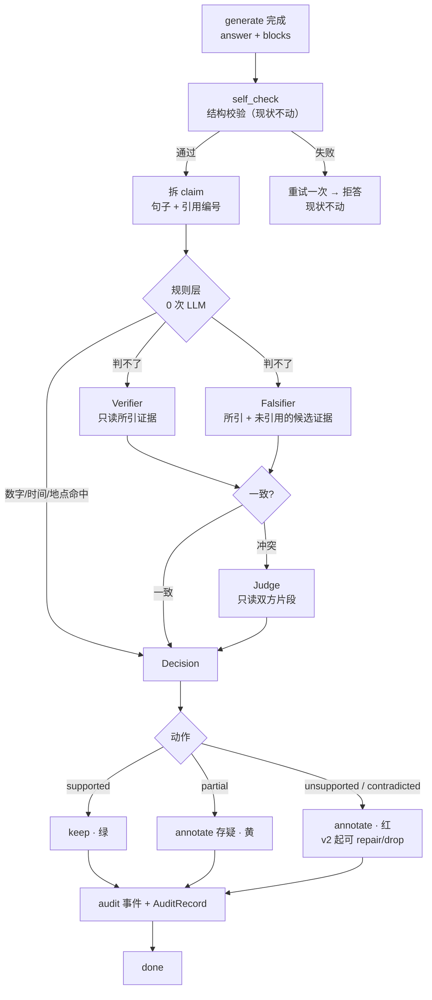

# 阶段 8（提案）：多 Agent 引用审计

> **状态：提案，未实现。** 本文只回答"往哪加、加什么、怎么证明它值得加"，
> 不替代阶段 0~7 的任何验收口径。
>
> 一句话：**把"引用率 100%"从"每句带 `[n]`"升级为"每句都被核对过"**，
> 方法是三条零成本规则 + 两个异质审计员 + 一个只在冲突时出场的裁判。

---

## 0. 先说结论：多 Agent 只该加在一个地方

| 环节 | 要不要多 Agent | 理由 |
| --- | --- | --- |
| 生成回答 | ❌ 不要 | 瓶颈在证据不在推理。你已经用检索 + 拒答把"没证据就闭嘴"做完了，再让三个模型辩论只会把 P95 和成本翻倍，收益在开放域推理题上才显著（RECONCILE / ChatEval 的评测集都是 reasoning / NLG evaluation，不是 grounded QA） |
| 工具调用 | ❌ 不要 | 工具选择准确率已经是 22/22。加一个"工具评审员"是在给一个不存在的错误上保险 |
| 行程规划 | ⚠️ 可选 | Planner + 约束检查器（营业时间、路程耗时）确实需要多角色，但**评测口径模糊**：什么叫"好行程"没有金标准，做完也拿不出硬指标。放 demo，不放主线 |
| **引用审计** | ✅ **就是这里** | 生成的目标函数是"说对"，审计的目标函数是"找出错"。两者天然对立，且审计需要**生成时没看到的证据**。单模型自查会被同一套上下文锁死——这正是 RECONCILE 说的 echo chamber |

只做这一处，做深，做出可复现的数字。**不要**把"多 Agent"铺到五个环节，
那会在面试里变成"你们每个地方都试了一点"。

### 0.1 如果你想要更"多 Agent"的观感

同一套协议可以复用到行程规划，作为**演示场景**（不进主线）：

```
Planner（生成行程） → ConstraintChecker（只能调 calculate_route / search_poi）
                    → Critic（用审计同一套 verdict 判"约束是否被满足"）
```

三个角色的**工具权限不同**，这是真协作：Checker 能查路线耗时，Planner 不能；
Critic 不生成，只判。评测口径用「约束违反率」（超时、闭馆、绕路），
不用"行程好不好"——后者没有金标准，写进报告会被一眼看穿。

它的价值是 demo 现场好看，不是指标好看。别让它挤掉审计主线的工期。

---

## 1. 现状：三个缺口，一条比一条具体

### 1.1 `self_check` 管的是"有没有引用"，不是"引用对不对"

`app/agent/nodes/pipeline/self_check.py::collect_violations` 只有三条判断：

1. 每个非软句的事实句必须含 `[n]`；
2. `[n]` 不越界；
3. 拒答里不许出现 `[n]`。

这三条全是**结构约束**。模型把 `[3]` 贴在一句和 `[3]` 毫无关系的话后面，
它照样通过——因为 `[3]` 存在，且没越界。

于是"引用率 100%"这个硬指标的真实含义是：
**每一句都挂了一个合法编号**，而不是**每一句都被证据支持**。

这不是实现缺陷，是指标的**设计边界**。承认它，才有升级空间。

### 1.2 忠实度是"整篇 0/1"，且只在评测时算

`app/agent/eval/metrics.py::parse_faithfulness` 把裁判输出解析成 0 或 1，
挂在 `EvalRow.faithfulness` 上，且只在 `EVAL_LLM_JUDGE=true` 时跑。

两个问题：

- **粒度错**：五句话里错一句，整篇记 0；用户不知道错的是哪一句，你也不知道该改哪一句；
- **不在运行时**：评测能发现的问题，线上照样发给用户。

### 1.3 真实错误长什么样

旅行记忆场景里，模型几乎不会"凭空编一个不存在的城市"，它犯的是这五类：

| 类型 | 例子 | 只有谁能发现 |
| --- | --- | --- |
| 数字无出处 | "这一趟一共走过 **12** 个城市 [1]"（证据里没有 12） | 比对数字即可 |
| 时间挂错 | "你**去年秋天**去了洛阳 [3]"（[3] 摄于 2025-03） | 比对 `taken_at` 与 query 时间窗 |
| 地点串行 | "你在**苏州**观前街住过 [2]"（[2] 是洛阳的照片） | 比对 `place` |
| 过度概括 | "你**最喜欢**杭州的寺庙 [1]"（证据只说了去过灵隐寺） | 语义蕴含 |
| 否定翻转 | "你去年**没能**上老君山 [1]"（证据说上去了） | 语义蕴含（且字面方法看不见） |

前三类**零成本可判**，后两类必须上模型。这个分布决定了架构：
**规则先行，模型兜底**，而不是反过来。

---

## 2. 架构



### 2.1 角色表

| 角色 | 目标函数 | 能看到什么 | 输出 | 失败处理 |
| --- | --- | --- | --- | --- |
| **规则层**（不是 agent） | 精确判定可判定的 | claim + 所引证据原文 + 元数据 + query 时间窗 | `Opinion(verdict, span, reason)` | 不适用（纯函数） |
| **Verifier** | 最大化"找到支持" | claim + **所引**证据 | `supported / partial / unsupported` + 原文片段 | 超时 → 该 claim 记未审计 |
| **Falsifier** | 最大化"找到反证" | claim + 所引证据 + **未被引用的 top-4 候选** | `contradicted / unsupported / 未找到反证` + 原文片段 | 同上，不阻塞 Verifier |
| **Judge** | 在冲突中判谁对 | claim + 双方片段 + 置信度，**不读原始长文** | 最终 verdict + 置信度 | 失败 → 保守判 `partial` |

### 2.2 关键设计：独立性来自"信息集不同"，不是"人设不同"

这是整套方案唯一值得写进简历的判断，展开说：

- ChatEval 的结论是"角色描述必须多样，同一个 persona 会掉点"——它证明了**人设**有用；
- RECONCILE 的结论是"多模型比同模型多实例好 6.8 个点"——它证明了**来源**比人设更关键；
- 但一个学生团队只有一个 API Key，拿不到 GPT-4 + Claude + Bard 三家。

所以真正可负担的多样性是第三条路：**让两个审计员看到不同的证据**。

生成时模型只用了它挑中的 top-k；Falsifier 拿到的恰恰是它**没挑**的那几条。
这不是"换个说法再问一遍"，这是"换一个观察函数"。
同模型、同 prompt 模板、不同输入分布，也能产生不相关的错误——
而且成本和多跑一次生成一样。

**消融必须验证这一点**：`3× 同人设同证据` vs `2× 异质信息集`。
如果前者不输，说明这个论点在你的数据上不成立，应该老实写进报告。

### 2.3 为什么 Judge 只读片段

裁判拿到整篇证据会被长度淹没，倾向于"看起来都对"。
只给它双方各自引用的那一两句原文，它做的是一个**短文本核对**任务——
难度低、可解释、且它的输入可以被程序校验（片段必须逐字存在于证据里）。

---

## 3. 编排：成本、预算、停止条件

### 3.1 三层门控

| 层 | 范围 | 成本 | 说明 |
| --- | --- | --- | --- |
| 回答级 | 意图 = `fact` 且有引用 | 0 | `plan` / `recommend` 直接跳过（阶段 5.3 已经踩过"用事实尺子量规划题"的坑） |
| 规则层 | **所有**带引用的 claim | 0 | 纯字符串/区间比较，没有理由省 |
| LLM 层 | 规则判不了的 claim，按风险权重排序后取前 6 条 | 2~3 次批量调用 | 不是"每条 claim 三次调用" |

第 6 条之后的 claim 显式记 `budget_cap`，**不假装审过**。

### 3.2 硬上限（缺一不可）

```python
MAX_CLAIMS = 6          # 单次问答最多审几条
CALL_TIMEOUT_MS = 700   # 单次审计调用超时
BUDGET_MS = 1500        # 审计总墙钟，超了立即降级
MAX_ROUNDS = 1          # 不迭代。RECONCILE 实测两轮后饱和，第三轮纯烧钱
```

超时/失败一律 `degraded=True` + `action=keep` + `note=degraded`，
答案照常返回，前端徽章显示"未审计"。**审计失败不允许拖垮回答**——
这是 PROJECT.md 红线 [8] 的直接推论。

### 3.3 成本估算（用你仓库里的价格表，不是拍脑袋）

`core/llm.py::_PRICE_PER_MTOKENS` 里 `qwen3.7-plus` = (0.40, 1.60) 元/百万 token。

一次批量审计调用假设 2000 输入 + 300 输出：
`2000×0.40/1e6 + 300×1.60/1e6 ≈ ¥0.0013`。
两次（Verifier + Falsifier）≈ **¥0.0026**；命中冲突再加一次 ≈ ¥0.0039。

对比 10.1 里"单次问答 < ¥0.05"：审计把成本抬到 **~1.1 倍量级**（生成本身占大头），
不是数量级变化。**但这是假设值**——上线后必须用 `AgentRun.token_usage`
实测，把真实数字写进看板，禁止拿这段估算当结论。

### 3.4 延迟

审计发生在 `generate` 之后，**不影响首字延迟**（P95 < 3s 的口径不变），
只影响 `done` 的时间。若审计超标，用户已经看到答案，只是徽章迟到——
这比"为了审计把首字拖到 5 秒"好得多。

---

## 4. 判定与动作

### 4.1 合并规则

```
任一带有效 span 的 contradicted      → contradicted
否则按 角色权重 × 置信度 加权求和      → 取最高
最高与次高差 < 0.15                  → partial（保守）
```

角色权重：Verifier 1.0 / Falsifier 1.3 / Judge 2.0。
反驳者权重更高，因为在"是否被支持"这件事上，**放过一句错话的代价大于多标一句存疑**。

### 4.2 `span` 是硬约束

- `contradicted` 必须给出证据原文片段，且片段必须能在证据里**逐字找到**；
- 找不到 → 该意见作废，不参与合并。

这条防的不是模型偷懒，是防它**编造反证**。一个假的反证会让裁判采信一个假结论，
比不审计更糟。

### 4.3 动作矩阵（v1 只标注，不改写）

| verdict | v1 动作 | 用户看到 | v2（指标达标后） |
| --- | --- | --- | --- |
| supported | keep | 绿色"已核验" | 同左 |
| partial | annotate | 黄色"部分存疑" | 删掉不被支持的分句 |
| unsupported | annotate | 红色"依据不足" | 换引用 / 删句 |
| contradicted | annotate | 红色"与证据矛盾" | 删句；删空则拒答 |

**v1 刻意不改写答案**。理由：删错一句的伤害大于标出一句——
用户还能自己看证据，但被删掉的信息他永远看不到。
先把"能不能判准"证明出来，再谈"要不要动手改"。

---

## 5. 可审计：让每个判定都能被回放

### 5.1 `AuditRecord`

```json
{
  "run_id": "...",
  "prompt_version": "audit-v1",
  "claims": [
    {"claim_id": "c3", "text": "你还顺路去了洛阳的龙门石窟 [3]",
     "cited": ["3"], "risk_tags": ["multi_citation"]}
  ],
  "opinions": [
    {"role": "rule:time", "verdict": "contradicted",
     "span": "2025-03-20 洛阳：龙门石窟，伊河两岸的佛龛群。",
     "reason": "所引证据拍摄于 2025-03-20，不在 2024-09-01~2024-11-30 内"}
  ],
  "decisions": [
    {"claim_id": "c3", "verdict": "contradicted", "action": "annotate",
     "confidence": 0.95}
  ],
  "degraded": false,
  "calls": 2,
  "cost_cents": 0.26
}
```

落点：`AgentStep`（已有表）+ JSONL trace + `AgentRun.token_usage`。
不新建表——阶段 5 的看板已经能读 `AgentStep`，加一张表就要再写一套聚合。

### 5.2 前端：三态徽章，语义与阶段 7 一致

| 徽章 | 含义 | 对应 |
| --- | --- | --- |
| 🟢 已核验 | 找到了支持它的原文 | 阶段 7 的"绿 = 证实" |
| 🟡 部分存疑 | 一部分被支持，一部分没有 | 新增 |
| 🔴 依据不足 / 与证据矛盾 | 反证成立，或找不到支撑 | 阶段 7 的"红 = 证伪" |
| ⚪ 未审计 | 超预算 / 非事实意图 | 阶段 7 的"灰 = 未证实" |

**颜色不能混用**：灰不是"错"，是一直没验。这一点阶段 7 已经写过一次，
审计徽章必须沿用同一套语义，否则同一个界面上两种"灰"含义不同。

点开徽章 → 高亮对应证据 + 展示 `span`。这与你已有的"点 `[1]` 地图 flyTo"是同一个交互，
只是多了一层"这句话被谁、依据哪一段核过"。

### 5.3 哈希链（可选，复用现成机制）

阶段 7 的 `prev_hash` 已在用。把 `AuditRecord` 的摘要串进去，
就得到"这次回答的审计记录没有被事后改过"的证明——**不加新依赖，不引入链**。
不要为此引入 AgentChain 的质押/VRF/共识，那些解决的是多租户互不信任，
你的场景是单用户，没有对手方。

---

## 6. 评测：这一节决定项目能不能拿去面试

### 6.1 数据

**A. claim 级标注（主集）**
29 条用例预计拆出 120~160 条 claim（以实际标注为准）。
两人独立标注，分歧仲裁，报 Cohen's κ；κ < 0.6 说明标注口径没定义清楚，先改口径再谈模型。

标签四档与运行时一致：`supported / partial / unsupported / contradicted`。
**不要用 0/1**——"部分支持"占真实错误的大头，二值化会把它压成噪声。

**B. 注入式对抗集（40 条，自动生成）**
拿现有 29 条用例里**正确**的回答，用 5 个变异算子各生成 8 条：

| 算子 | 变换 | 期望检出 |
| --- | --- | --- |
| `swap_citation` | 把 `[2]` 换成另一条证据的编号 | place / verifier |
| `shift_number` | 把数字 +3 或 ×2 | rule:number |
| `shift_date` | 把证据 `taken_at` 挪出 query 时间窗 | rule:time |
| `add_superlative` | 插入"最/每次/唯一" | falsifier |
| `negate_predicate` | 在谓词前加"没/未" | verifier（字面方法会漏） |

自动生成的好处：**错误类型可控、可复现、可扩量**，且不依赖人工编造。
面试时可以一句话说清："我们自己造了 40 条定向攻击，按类型报召回。"

### 6.2 基线矩阵

| 编号 | 策略 | 说明 |
| --- | --- | --- |
| B0 | 结构检查 | 现状 `self_check` |
| B1 | 单裁判 | 一次调用判整篇 0/1（现状的 `faithfulness`） |
| B2 | 3× 同人设同证据 | 证明"多喊几个人"本身没用 |
| B3 | 异质信息集（Verifier + Falsifier） | 本方案核心 |
| B4 | B3 + Judge | 冲突仲裁的增量 |
| B5 | B4 + repair | v2，先不改写 |

**B2 必须跑**。它是整个论证的对照组：如果 B2 ≈ B3，说明"信息集不对称"
在你的数据上没有价值，那就把结论改成"多 Agent 不比单裁判好，我们只保留了规则层"——
这同样是一个合格的工程结论，而且比硬吹更让人信服。

### 6.3 指标与通过线

| 指标 | 定义 | 目标 |
| --- | --- | --- |
| Claim F1 | 以 `verdict.is_bad` 为正类 | ≥ 0.75 |
| 误伤率 | 好 claim 被标非 keep / 全部好 claim | ≤ 8% |
| **未标记错误率** | 含坏 claim 的回答里，坏 claim 仍 `keep` 的比例 | ≤ 5% |
| 否定类召回 | 单独报（字面方法已知为 0） | ≥ 0.6 |
| 增量成本 | 每次问答多花的 token 折算 | ≤ 1.5× |
| 增量延迟 | `done` 推迟的 P95 | ≤ 800ms |
| 裁判-人一致 | 与人工标注的 κ | ≥ 0.5 |

**未标记错误率是主指标**，不是 F1。因为产品承诺是"你读到的每句话都有据可查"，
用户不关心你内部 F1 多少，只关心有没有一句假话被当成真的递给他。

### 6.4 怎么写结论（正负都要写）

- 正：`B3 把未标记错误率从 1.00 降到 0.17，误伤 0，成本 +1.2×`（原型数字，仅示意口径）
- 负：`B2 与 B3 差距 < 3 个点 → 信息集不对称在该任务上无效，仅保留规则层`

**负结论不要藏。** 面试官问"多 Agent 到底有没有用"，能给出边界的人
比只会说"有用"的人可信得多。

---

## 7. 落点：改哪些文件

| 文件 | 改动 |
| --- | --- |
| `app/agent/nodes/audit/` | 新增：`claims.py` / `rules.py` / `council.py` / `repair.py` |
| `app/agent/prompts/audit/` | 新增三份 prompt，`prompt_version = audit-v1` |
| `app/agent/state.py` | `PipelineState.audit: object \| None` |
| `app/agent/pipeline.py` | `self_check` 通过后调 `run_audit()`，发 `audit` 事件 |
| `app/agent/nodes/graph/graph.py` | 同一个 `run_audit()`，**不要各写一份**（阶段 4 的教训：两条运行时行为必须一致） |
| `app/agent/events.py` | `audit_event(state)` |
| `app/core/config.py` / `feature_flags.py` | `AUDIT_ENABLED=false`、`AUDIT_MAX_CLAIMS`、`AUDIT_BUDGET_MS` |
| `app/agent/eval/metrics.py` | `attribution_f1` / `unflagged_error_rate`（纯函数） |
| `app/agent/eval/dataset.py` | 读 claim 级标注文件 |
| `app/agent/eval/runner.py` | `--audit` 档位 |
| `app/scripts/export_dashboard.py` | 一张"审计覆盖 / 未标记错误率"卡片 |
| `tests/test_audit_*.py` | 规则单测 + 协议降级测试 + 对抗集回归 |
| `tests/test_degradation.py` | 加断言：`AUDIT_ENABLED=false` 时前七阶段指标不变 |

**开关默认关**。这是红线 [8]，也是你给面试官演示"我做的功能是可拆卸的"的最好证据。

---

## 8. 三周计划（按里程碑，不按功能）

| 里程碑 | 内容 | 出口 | 止损 |
| --- | --- | --- | --- |
| **M1（1 周）** | 规则层 + claim 拆分 + 标注 60 条 + B0/B1 基线 | 未标记错误率相对 B0 下降 ≥ 40%，0 次 LLM 调用 | 若规则层降幅 < 20%，说明真实错误以语义类为主，直接进 M2，不要堆规则 |
| **M2（1 周）** | Verifier + Falsifier + 批量 + 预算降级 + B2/B3 | B3 的 F1 比 B2 高 ≥ 8 个点 | 若 B2 ≈ B3，停在这里，交付"规则层 + 单裁判"，把负结论写进报告 |
| **M3（1 周）** | Judge + 前端徽章 + 看板 + 全量消融 + 文档 | 未标记错误率 ≤ 5%，误伤 ≤ 8%，成本 ≤ 1.5× | 若不达标，保留标注能力，关闭默认审计 |

M1 单独就能讲一个故事：**"我先用 0 成本的规则抓掉了大部分引用错配，再决定要不要上模型。"**
这句话本身就是工程判断力。

---

## 9. 面试怎么讲

### 9.1 四句话版本

1. 我的项目有一个硬指标：事实性回答引用率 100%。做到后来我发现，它只保证**每句带编号**，不保证**编号支持这句话**。
2. 我把这个指标拆成"引用存在性"和"引用忠实性"，做了 claim 级审计：三条零成本规则（数字/时间/地点）+ 两个信息集不同的审计员 + 冲突才出场的裁判。
3. 我做了五组消融，包括一组"三个人同人设同证据"的对照组。结论是收益来自**信息集不对称**，不是角色扮演；否定类错误字面方法抓不到，必须上语义。
4. 审计默认关闭，打开后把未标记错误率从 X 降到 Y，成本 +Z%，答案流式延迟不受影响。

### 9.2 大概率被追问的问题

| 问题 | 怎么答 |
| --- | --- |
| 为什么不直接微调一个校验模型？ | 标注量不够（百级），微调不出稳定判别器；且规则/协议可解释、可增量修，模型不行。等标注上千再考虑。 |
| 为什么不所有请求都审？ | 成本与收益不成比例。规划/推荐类没有事实断言，审它等于用错尺子——这一点我在阶段 5.3 已经踩过一次坑。 |
| 裁判自己错了怎么办？ | 三层约束：片段必须逐字存在、裁判只读片段不读长文、与人工标注算 κ。κ 不达标就换 prompt 或降级为单裁判。 |
| 多 Agent 是不是噱头？ | 有一组对照实验专门回答这个：同人设三票 vs 异质信息两票。差距不显著我会写"不显著"。 |
| 为什么不用 LangGraph 的多 Agent 能力？ | 编排不是瓶颈，`AGENT_RUNTIME` 已经能切。审计是生成后的**纯函数式后处理**，两条运行时共用一个函数，避免行为分叉。 |
| 这跟 AgentChain 有什么关系？ | 只借了"角色分离 + 判定要留证"。它的共识、质押、VRF 解决的是多租户互不信任，我是单用户产品，没有对手方，引进来是纯负债。 |

### 9.3 简历怎么写（一行）

> 为 RAG Agent 设计 claim 级引用审计：规则层零成本拦截数字/时间/地点错配，
> 语义层用异质信息集双审计员 + 冲突仲裁；五组消融定位收益来源，
> 未标记错误率 X% → Y%，默认关闭可回滚。

不要写"使用多 Agent 协作提升可信度"——那句话谁都能写，且不可证伪。

---

## 10. 三篇论文：取什么，不取什么

| 论文 | 取 | 不取 | 理由 |
| --- | --- | --- | --- |
| **ChatEval** (ICLR'24) | 评审团适合**评估**而非生成；角色必须异质，同人设会掉点 | 三角色辩论文本评估的产品化 | 它的任务是"评两段文本谁更好"，输出是偏好，不是可执行的事实判定 |
| **RECONCILE** (ACL'24) | 多样性来自**模型/来源**而非实例；置信度加权投票；两轮后饱和 | 多模型圆桌 | 你只有一个 API Key；用"信息集不同"替代"模型不同"，成本可控 |
| **AgentChain** (TDSC'26) | 角色分离（proposer / evaluator）；评估也要被评估；判定留痕不可抵赖 | 区块链、PoCQ、质押、VRF、去中心化议会 | 单用户单租户，共识没有对象；引入后只是把 trace 换成更贵的 trace |

一句话：**借机制，不借基础设施。**

---

## 11. 待确认

1. 真实错误分布未知：M1 的标注会给出答案，**在标注完成前不要定架构**。
2. 是否已有 `EVAL_LLM_JUDGE=true` 的历史评测结果？若有，可直接算 B1 基线，省一周。
3. 推理模型（`qwen3.7-plus` 已关 thinking）在"判定"任务上的稳定性未测；
   若 JSON 输出不稳，先上 `response_format` 或改两段式（先判后引）。
   核实方式：拿 20 条标注样本跑三次，看自一致率。
